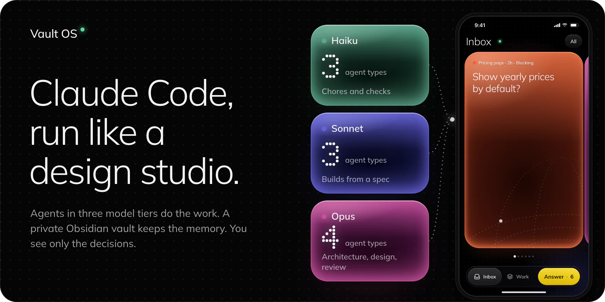
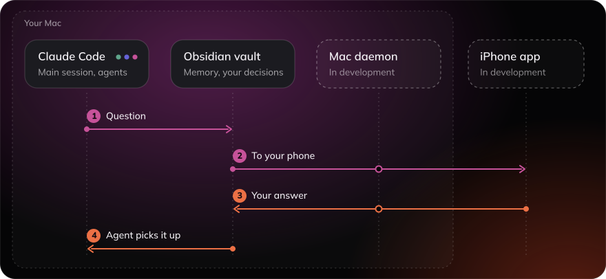
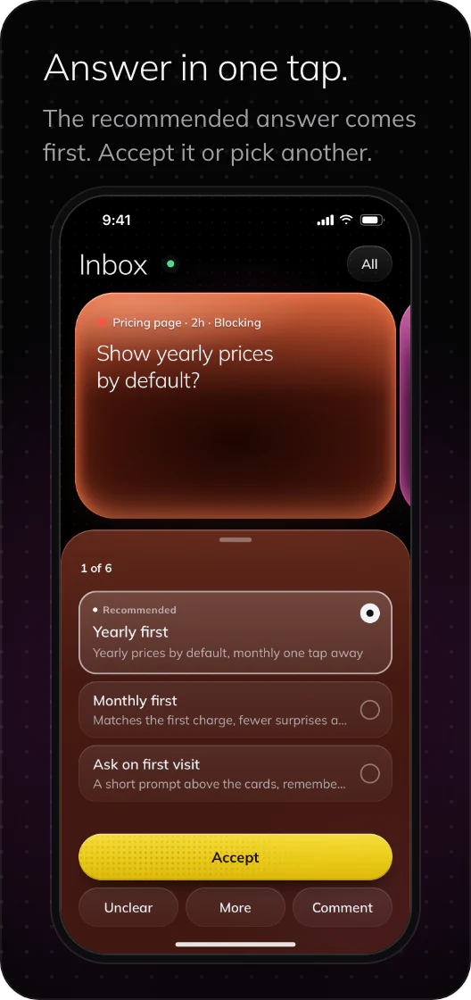
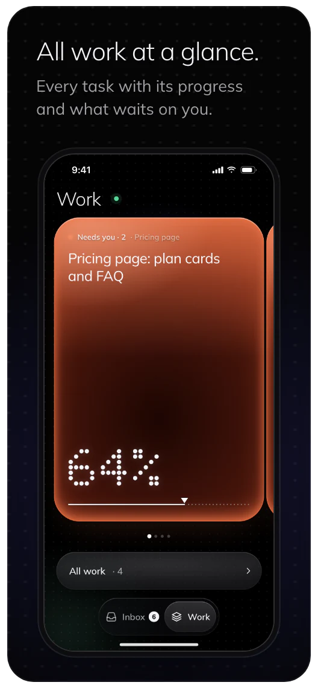
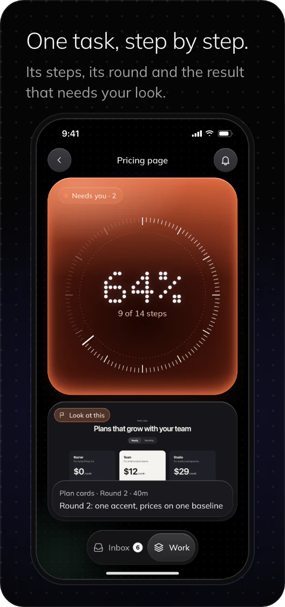
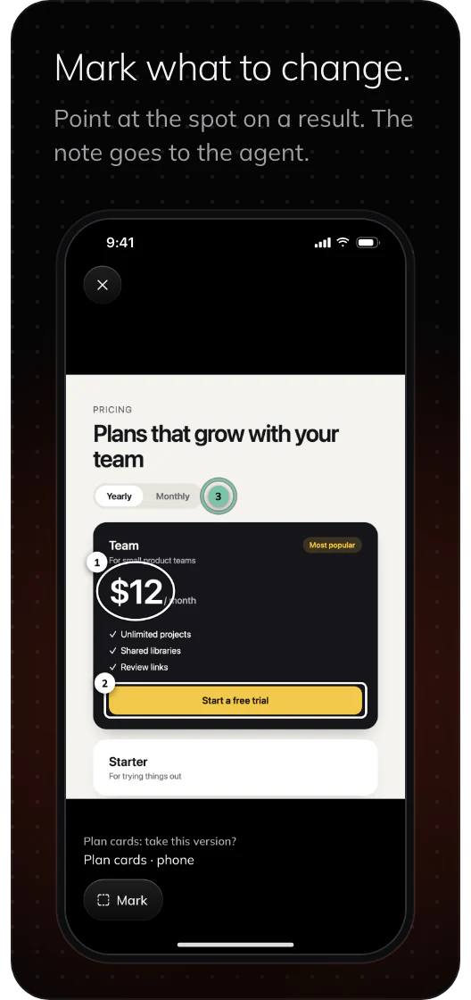
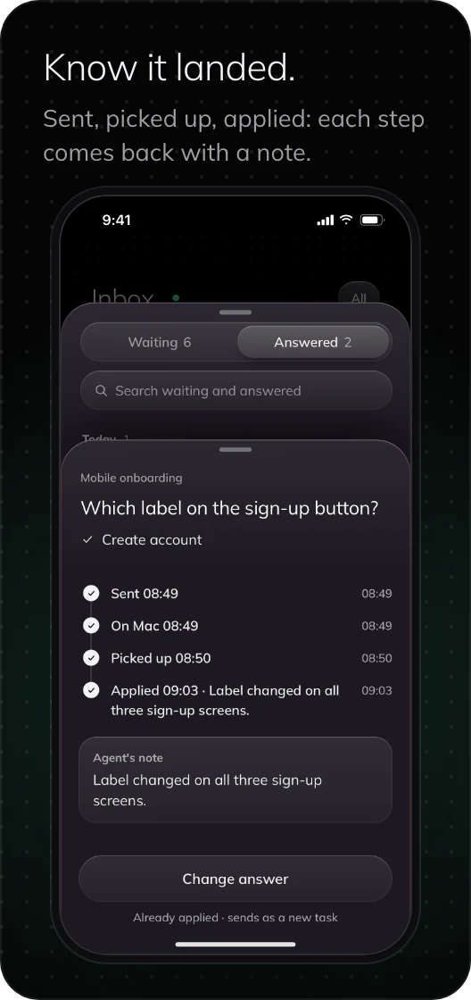

<p>
<picture>
  <source media="(max-width: 600px)" srcset="docs/readme/hero-narrow.webp">
  
</picture>
</p>

**Vault OS** is a ready-made setup for Claude Code: a main session that plans and delegates, agents on the right model for each job, a private Obsidian vault for memory, and guards that keep long unattended work safe. It is made for people who design and build product UI with Claude Code every day.

[Walkthrough site](https://mrdesign-ww.github.io/vault-os/) · [Install guide](INSTALL.md) · [Upgrade and rollback](installer/UPGRADE.md) · [Changelog](CHANGELOG.md)

> [!NOTE]
> This repository ships the system only: no projects, notes, session traces, accounts, tokens, private paths or client material.

## How it works

<p>
<picture>
  <source media="(max-width: 600px)" srcset="docs/readme/how-it-works-narrow.svg">
  
</picture>
</p>

You give the main Claude Code session a task. It splits the work and starts agents by tier: Haiku for chores and checks, Sonnet for builds from a spec, Opus for architecture, design and review. Each role reads a small, budgeted set of notes from the vault, so an agent starts with the context its job needs. When a choice is yours, the work waits for you. With the app, a question takes this path:

1. **Question.** The agent asks you a question: the options, its recommendation and room for your answer.
2. **To your phone.** The Mac daemon sends the question to the iPhone app.
3. **Your answer.** You tap an option or record a voice note, and the answer goes back to the agent.
4. **Agent picks it up.** The waiting agent goes on, then reports what it applied in a one-line note.

The Mac daemon, the iPhone app and the decision board are in development. Until they ship, questions come to you in the chat, or in the decision channel you set up for a project.

## The iPhone app

> [!NOTE]
> In development. The app and the board come to this repository when they are done. These are real screens of the current build, shot with made-up demo data.

<p align="center">
  
  
  
  
  
</p>

Also in the works: a push for each new question, and several questions from one task shown as one stack.

## What's inside

| Part | What you get |
| --- | --- |
| Agents | 10 agent types in three model tiers. Haiku: `runner`, `checker`, `locator`. Sonnet: `builder`, `worker`, `look-reviewer`. Opus: `architect`, `reviewer`, `product-designer`, `general-purpose`. |
| Rules | Global rules plus an orchestration doc for main sessions: one fresh agent per task, briefs with at most 3 required documents, at most two fix rounds on a part before the method changes. |
| Memory | An empty, private Obsidian vault: PARA folders, work, personal and client zones kept apart, four trust levels, from raw evidence to rules you approved, and a local index per zone that refuses to answer when it is stale. |
| Guards | Hooks for unattended work: no process kills by pattern and no `rm` with globs, a pause at 98% of the weekly usage limit, a snapshot before compaction, big-image downscaling for build agents (macOS), and a daily check for a newer release. |
| Design layer | `skill-router` (1 to 3 skills per job), `figma-craft` with read-only Figma gate scripts, the `product-designer` agent, and design-spec and design-round templates. |
| Skills | 74 bundled skills, each with its source and licence, and 33 plugin entries after install (9 on, the rest off until you turn them on). gstack and Remotion come from their upstream at a pinned commit with `--upstream-skills`. |
| Codex | Optional: the vault ships a Codex contract, and the installer adds hooks, plugins and skills to Codex. |

## Safe to install, safe to upgrade

- **Plan first.** The upgrade shows its full plan and changes nothing without your yes.
- **Your files stay yours.** Notes, attachments, memory, sessions and credentials are never deleted. An upgrade may move notes into the vault structure and rewrite their links; credentials and sessions are never touched.
- **Everything removed is archived.** System folders end up matching the release exactly. Whatever the upgrade removes or overwrites there, your own skills in `~/.claude/skills` included, is first copied to `~/vault-os-backups/<time>/`, and nothing deletes that archive.
- **Rollback.** `rollback` first shows what it will restore, keep and move aside, and runs only with `--confirm` and that preview's id. Right after an upgrade it returns the exact previous tree; notes and commits you made since then stay.
- **Crash safe.** `recover` rolls back an upgrade that was killed halfway.
- **Your permission mode.** Bypass mode is turned on only when you choose it in the setup quiz.

Details: [`installer/UPGRADE.md`](installer/UPGRADE.md).

## Install

You need Git, Python 3, Node.js, Claude Code and Obsidian. The full system runs on macOS and Linux, and on Windows through WSL. The Claude layer alone also installs natively on Windows.

Open Claude Code and say:

```text
Install https://github.com/mrDesign-ww/vault-os
```

Claude follows [`INSTALL.md`](INSTALL.md): it asks a short trust and setup quiz, then creates a new private vault and installs the Claude layer. On a machine that already has a Claude setup or an older Vault OS, say:

```text
Update Vault OS from https://github.com/mrDesign-ww/vault-os
```

<details>
<summary>Render a vault by hand</summary>

```bash
python3 installer/render-vault.py \
  --target "/absolute/path/to/new-vault" \
  --owner "Owner Name" \
  --title "Vault Title" \
  --client-label "Client" \
  --approve-memory-policy
```

Use the approval flag only after the owner explicitly approves the bundled memory rules during installation.

</details>

## What's new

**2026.10.20.** The global Claude layer (10 agent types, rules, an orchestration doc, hooks and a status line), the design layer, 74 bundled skills, and a clean install and full upgrade with rollback. All notes are in [`CHANGELOG.md`](CHANGELOG.md).

## Privacy boundary

- Obsidian files stay the source of truth on your machine.
- Generated retrieval indexes and session traces stay local and are ignored by Git.
- Small receipts for each index are committed locally, so retrieval can tell when an index is stale or was never reviewed.
- Personal and client zones are kept out of the optional memory review, which is off by default.
- Authentication files, local MCP configuration, hook trust hashes and existing user settings are never shipped.
- Optional third-party plugins and connected services have their own network and privacy policies. Vault OS itself does not upload vault contents.
- Bundled hyperframes and media-use skills send anonymous usage telemetry to HeyGen; opt out with `HYPERFRAMES_NO_TELEMETRY=1` or `DO_NOT_TRACK=1`.

## Repository layout

```text
vault-os/
├── INSTALL.md
├── CHANGELOG.md
├── installer/
│   ├── render-vault.py
│   ├── install-claude-layer.py
│   ├── vault-os.py         # detect, upgrade, parity, rollback, recover (UPGRADE.md)
│   ├── vaultos/
│   ├── install-mac.sh
│   ├── install-windows.ps1
│   ├── quiz.md
│   └── steps.md
├── shell/
│   ├── claude/             # agents, hooks, docs, templates, status line, settings template, 74 skills
│   ├── codex/              # public plugin and hook templates, 92 Codex and ~/.agents skills
│   └── vault-template/     # empty vault, memory engine, hooks, and evolution runtime
├── tests/                  # installer, upgrade, rollback, migration, hooks and vault tests
├── docs/
│   └── readme/             # the images on this page
└── site/                   # the walkthrough site
```

## Verify the release

```bash
python3 -m unittest discover -s tests -v
```

The tests run every hook self-test, install the Claude layer into temporary homes for each platform, and build a clean vault that is checked end to end: its rules, a local Git repository, all three indexes and a live search. The upgrade tests install the previous public release next to a vault that did not come from Vault OS, upgrade it until nothing differs from the release, roll it back to the exact previous tree, kill the upgrade at every phase and recover it.

## License

[MIT](LICENSE) © 2026 mrDesign-ww. Bundled third-party skills keep their own licences, see [`shell/claude/skills/THIRD-PARTY-SKILLS.md`](shell/claude/skills/THIRD-PARTY-SKILLS.md).
